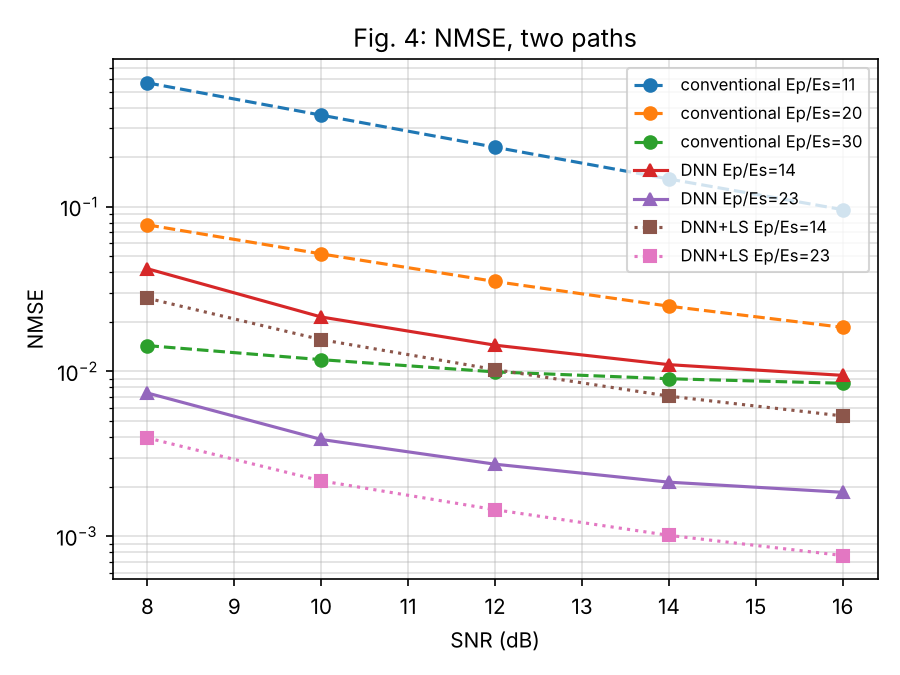
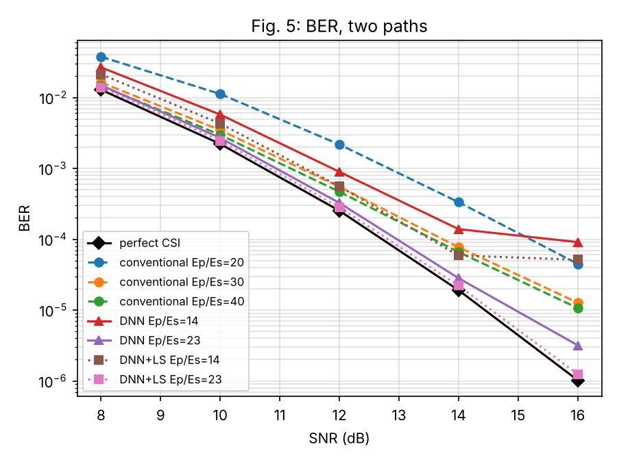
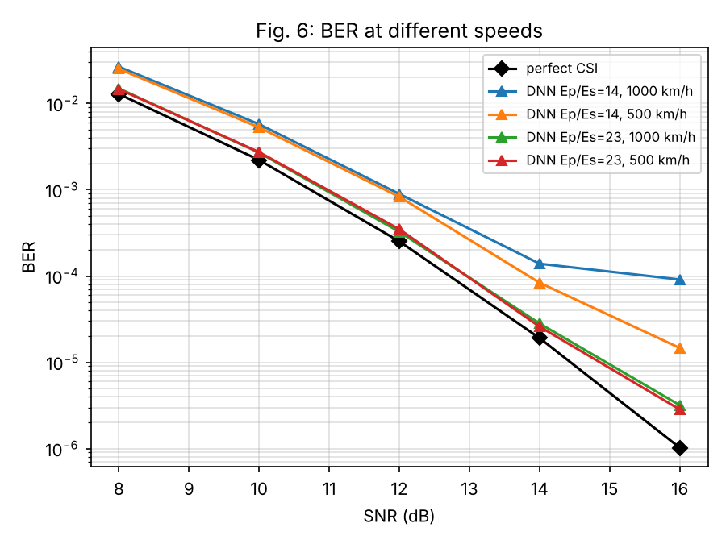
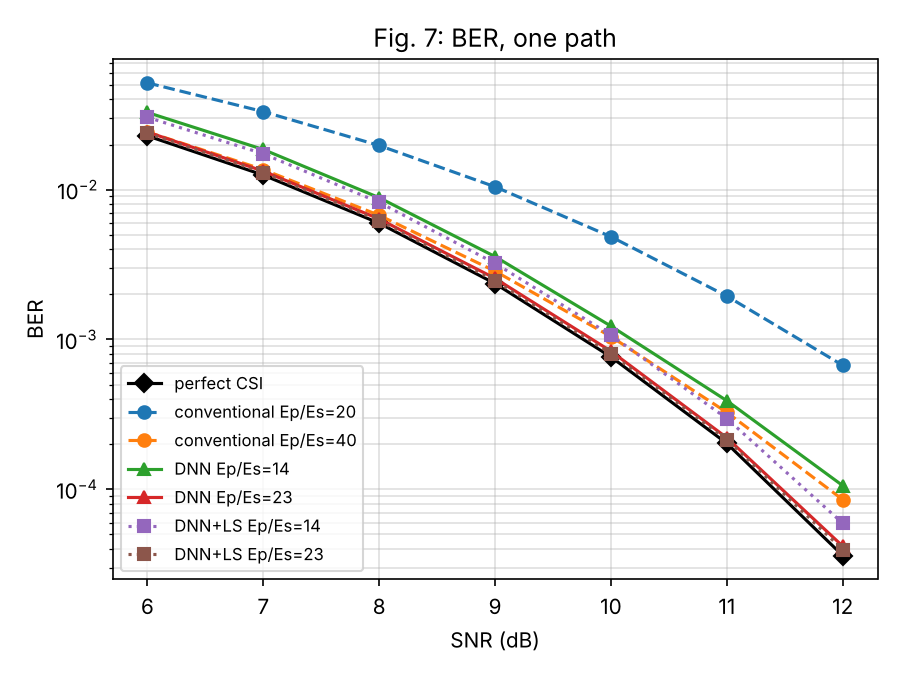

# DNN-Based Fractional Doppler Channel Estimation for OTFS
Reproduced by **Hania Tariq** 

A Python reproduction of

> L. Guo, P. Gu, J. Zou, G. Liu and F. Shu, "DNN-Based Fractional Doppler Channel Estimation for OTFS Modulation," *IEEE Trans. Veh. Technol.*, vol. 72, no. 11, pp. 15062–15067, Nov. 2023, doi: 10.1109/TVT.2023.3280901.

In high-mobility links, such as LEO satellites and UAVs at up to 1000 km/h, the Doppler shift falls between OTFS grid points. Its energy then spreads across the delay-Doppler grid, which makes the channel hard to estimate. The paper trains a small DNN that reads the received pilot and estimates only a few channel parameters per path: gain, delay and fractional Doppler. The full channel matrix is rebuilt from those parameters and passed to an MRC detector.

This repository implements the whole link from scratch in NumPy:
- the zero-padded OTFS system;
- a two-path channel with fractional Doppler;
- the DNN estimator;
- the conventional delay-time pilot estimator as the baseline;
- the delay-time MRC detector of Thaj & Viterbo (*IEEE TVT*, 2020).

It reproduces Figs. 4–7 of the paper.

## System parameters

| Parameter | Value | How it is obtained |
|---|---|---|
| Grid size M × N | 64 × 8 | paper |
| Subcarrier spacing, carrier | 15 kHz, 3 GHz | paper |
| Modulation | 4-QAM | paper |
| Max delay tap l_max | 4 | 4 µs ÷ delay resolution 1/(MΔf) = 1.04 µs |
| Max Doppler k_max | 1.48 bins | 2778 Hz at 1000 km/h ÷ Doppler resolution Δf/N = 1875 Hz |
| Guard rows L_ZP | 9 | 2 l_max + 1 |
| DNN | 80 → 256 → 128 → 14 | inputs 2(l_max+1)N, outputs 2(1+3P) with P = 2 |
| Training | ReLU, Adam, MSE loss, SNR 10 dB | paper |

## Results

| NMSE (Fig. 4) | BER, two paths (Fig. 5) |
|---|---|
|  |  |
| **BER vs speed (Fig. 6)** | **BER, one path (Fig. 7)** |
|  |  |


### Assumptions (not specified in the paper)
- **Channel (calibrated to the paper's figures):**
  - Two Rayleigh paths, with gains normalised to total power 1 in every frame. The one-path case (path-2 gain = 0) then gives |h| = 1, which matches the paper's Fig. 7 perfect-CSI curve (4-QAM in AWGN).
  - Path 1 at delay 0, path 2 at a random delay of 1–4 taps.
  - Doppler of each path uniform in [−k_max, k_max].
  - 20 % of training frames have a single path.
- **Conventional estimator:** the pilot gives the gain of all 5 delay taps at N time instants, with no tap threshold. A natural cubic spline then interpolates across the frame. This reproduces the paper's conventional NMSE curves.
- **DNN output:** 14 values: real and imaginary parts of {h1, h2, k1, k2, l1, l2, P}. Delays and P are rounded.
- **Pre-processing (added):** each received pilot row is phase-aligned before entering the DNN, and the rotation is undone afterwards. Inputs and targets are standardised.
- **Training schedule:** 400k samples for 60 epochs at learning rate 1e-3, then 20/20/10 epochs at 3e-4/1e-4/3e-5 on fresh data; batch 256.
- **MRC detector:** 15 iterations, the first 5 without hard decisions.
- **Framework:** scikit-learn `MLPRegressor`, with the same architecture as the paper.

## How to run

```bash
pip install -r requirements.txt

python -m pytest tests          # sanity checks (~1 s)
python train.py --ep 14         # train (optional, models/ already has trained networks, ~25 min each)
python train.py --ep 23
python evaluate.py --fast       # simulations for Figs. 4-7 (drop --fast for the full run)
python plot.py                  # figures -> figures/
```

No GPU is needed.

## Repository structure

```
otfs/
  config.py        system parameters
  channel.py       two-path fractional-Doppler channel, channel matrix g[l, q]
  system.py        OTFS transmitter, channel, receiver
  estimators.py    DNN input/output encoding, LS gain refinement, conventional estimator, NMSE
  detector.py      delay-time MRC detector, bit errors
train.py           dataset generation and DNN training
evaluate.py        NMSE / BER simulations -> results/results.json
plot.py            figures
tests/             simulator sanity checks
models/            trained networks (Ep/Es = 14 dB and 23 dB)
results/           simulation results
figures/           reproduced figures
```

## References
1. L. Guo et al., "DNN-Based Fractional Doppler Channel Estimation for OTFS Modulation," *IEEE Trans. Veh. Technol.*, vol. 72, no. 11, pp. 15062–15067, 2023.
2. T. Thaj and E. Viterbo, "Low Complexity Iterative Rake Decision Feedback Equalizer for Zero-Padded OTFS Systems," *IEEE Trans. Veh. Technol.*, vol. 69, no. 12, pp. 15606–15622, 2020.
3. 3GPP TR 38.811, "Study on New Radio (NR) to support non-terrestrial networks."


[def]: https://github.com/HANIA-Tariq